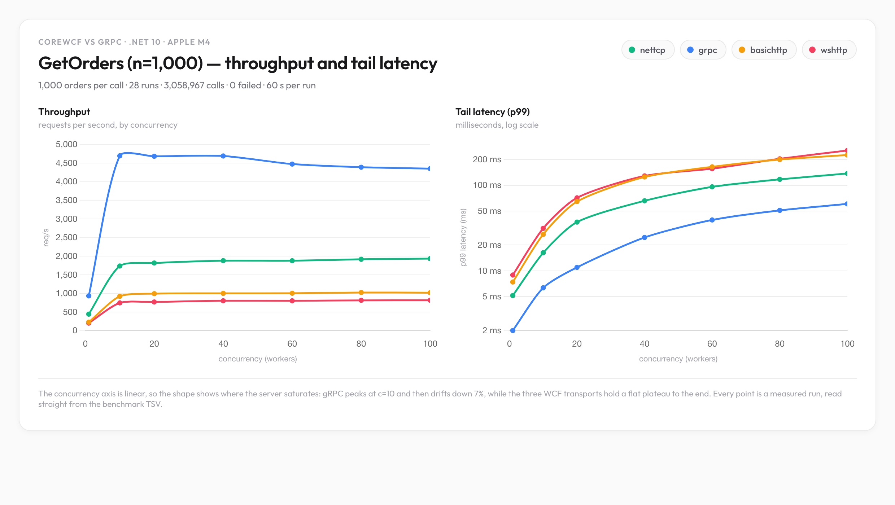
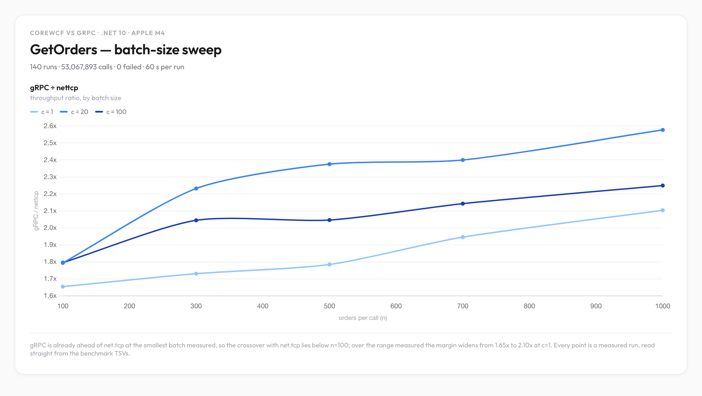

# WCF vs gRPC Benchmark

Micro-benchmark comparing **WCF (CoreWCF) over three transports** against **gRPC** for two
unary methods, on .NET 10 / C#: a single-order `GetOrderById` and a batch `GetOrders`
(10,000 orders by default). Both operations are swept across the full concurrency range and both
result sets are published below.

This benchmark was done as a fun excercise. Be aware of the following caveats
- Both client and server were ran on the same machine.
- The response of the `GetOrderById` method is hardcoded.  There is no additional logic apart from just returning an `Order` instance
- No finetuning was done on the gRPC or WCF servers
- The duration of the benchmark is just 60 sec (with a 10 sec warmup time)
- For `GetOrders` the harness measures the whole call including deserialization, so the batch numbers
  are a statement about the deserializer as much as about the wire.
- **Both processes run Server GC**, set explicitly in each csproj. Neither project uses
  `Microsoft.NET.Sdk.Web`, which is what would normally turn Server GC on, so it has to be requested.
  Every number published here was measured with that configuration.
- The WCF net.tcp endpoint needs `MaxBufferSize` raised well above the 64 KB default or the batch
  operation fails outright. See [Notes on the harness](#notes-on-the-harness).

## Transports compared

| Target | Transport | Endpoint |
|---|---|---|
| `wcf` `basichttp` | CoreWCF `BasicHttpBinding` (SOAP 1.1) | `http://localhost:5000/NorthwindWcfService/basic` |
| `wcf` `wshttp` | CoreWCF `WSHttpBinding` (SOAP 1.2 over HTTPS) | `https://localhost:5001/NorthwindWcfService/ws` |
| `wcf` `nettcp` | CoreWCF `NetTcpBinding` (binary over raw TCP) | `net.tcp://localhost:5002/NorthwindWcfService/nettcp` |
| `grpc` | gRPC over HTTP/2 | `http://localhost:5003` |

## Service methods

Both services expose the same two operations, so the transports can be compared on a single-order
and a batch response.

| Method | gRPC | WCF | Returns |
|---|---|---|---|
| `GetOrderById` | `rpc GetOrderById(OrderRequest) returns (Order)` | `Order GetOrderById(OrderRequest)` | one hardcoded order |
| `GetOrders` | `rpc GetOrders(OrdersRequest) returns (OrdersResponse)` | `OrdersResponse GetOrders(OrdersRequest)` | **10,000** orders |

Both `GetOrders` operations return a response wrapper holding the batch, which mirrors the
`OrdersResponse` message on both sides and leaves room for paging metadata later:

```
WCF     OrdersResponse { Order[] Orders }
gRPC    OrdersResponse { repeated Order orders }
```

`GetOrders` takes an optional `Count` (gRPC) / `Count` (WCF `OrdersRequest`). A value of 0 or less
means "use the server default" of 10,000. Max count is clamped to 1,000,000. The batch is materialised once and cached per process, because
rebuilding 10,000 orders on every call would measure the allocator rather than the transport.
 
Measured response payload on .NET 10, straight off the wire:

| Transport | Encoding | **n = 1,000** | n = 10,000 | bytes/order | vs gRPC |
|---|---|---|---|---|---|
| `grpc` | protobuf | **263,626 B** (0.251 MB) | 2,638,546 B | 263.9 | 1.00x |
| `nettcp` | binary XML | **323,785 B** (0.309 MB) | 3,234,685 B | 323.4 | 1.23x |
| `basichttp` | SOAP 1.1 XML | **1,154,714 B** (1.101 MB) | 11,565,085 B | 1156.7 | 4.38x |
| `wshttp` | SOAP 1.2 + WS-Addressing | **1,154,948 B** (1.101 MB) | 11,565,319 B | 1156.7 | 4.38x |

SOAP is **4.4x more verbose than protobuf** and 3.6x more verbose than net.tcp's binary XML. Measured
four different ways: `curl` reports the exact HTTP body length for the two SOAP transports,
`CalculateSize()` gives the exact protobuf encoding for gRPC, and a byte-counting TCP proxy measures
the real net.tcp framing. All four are deterministic - repeated net.tcp runs are byte-identical.

> An earlier version of this table gave `nettcp` as ~5.9 MB. That was an estimate ("about half of
> SOAP"), never measured, and it was wrong by 1.9x. The 3.09 MB above is measured.

Two things are worth noticing. The two SOAP transports have an **identical** marginal cost -
1156.71 bytes per order either way, difference 0.0000 - because they share the same
`DataContract` XML and differ only in a 234-byte WS-Addressing/SOAP 1.2 envelope. And protobuf
carries essentially no per-message envelope at all, so its size is pure payload.
 

## Environment

- macOS 26.5.2, Apple M4, 10 cores, 32 GB
- .NET SDK 10.0.100, `net10.0`
- CoreWCF 1.9.1, gRPC 2.84.0, `System.ServiceModel.Http` 10.0.652802

## Test Setup
- server warmup time `10 sec` (done to exlude connection setup and JIT time)
- test duration `60 sec` 
- concurrency levels `1/10/20/40/60/80/100` (simulates the number of concurrent clients. Each client has its own channel)

## Results

All results in this section are `GetOrderById`. The batch results are in
[their own section](#getorders-results).

Throughput and p99 tail latency at each concurrency level


| Concurrency | `nettcp` | `grpc` | `basichttp` | `wshttp` |
|---|---|---|---|---|
| 1 | **22,269** | 17,501 | 19,775 | 17,189 |
| 10 | **84,837** | 79,872 | 70,989 | 63,376 |
| 20 | **88,913** | 85,869 | 74,575 | 65,315 |
| 40 | **91,338** | 88,643 | 77,064 | 68,520 |
| 60 | **93,129** | 89,527 | 79,398 | 68,814 |
| 80 | **92,360** | 89,344 | 78,705 | 68,149 |
| 100 | **92,811** | 88,898 | 78,944 | 67,180 |


### Raw data

**Zero failed calls across all 28 runs** (120,199,172 successful requests). Latency in milliseconds.

| Transport | Conc. | Throughput | p50 | p90 | p95 | p99 | mean | max |
|---|---|---|---|---|---|---|---|---|
| `nettcp` | 1 | 22,269 req/s | 0.040 | 0.061 | 0.073 | 0.115 | 0.045 | 16.809 |
| `grpc` | 1 | 17,501 req/s | 0.053 | 0.078 | 0.090 | 0.121 | 0.057 | 9.159 |
| `basichttp` | 1 | 19,775 req/s | 0.044 | 0.064 | 0.078 | 0.136 | 0.050 | 11.365 |
| `wshttp` | 1 | 17,189 req/s | 0.051 | 0.071 | 0.087 | 0.154 | 0.058 | 9.971 |
| `nettcp` | 10 | 84,837 req/s | 0.108 | 0.137 | 0.154 | 0.211 | 0.118 | 15.134 |
| `grpc` | 10 | 79,872 req/s | 0.118 | 0.148 | 0.166 | 0.221 | 0.125 | 6.027 |
| `basichttp` | 10 | 70,989 req/s | 0.125 | 0.164 | 0.189 | 0.268 | 0.141 | 13.222 |
| `wshttp` | 10 | 63,376 req/s | 0.141 | 0.186 | 0.215 | 0.307 | 0.158 | 18.626 |
| `nettcp` | 20 | 88,913 req/s | 0.209 | 0.263 | 0.289 | 0.386 | 0.225 | 19.759 |
| `grpc` | 20 | 85,869 req/s | 0.224 | 0.278 | 0.300 | 0.370 | 0.233 | 23.133 |
| `basichttp` | 20 | 74,575 req/s | 0.240 | 0.309 | 0.351 | 0.565 | 0.268 | 15.511 |
| `wshttp` | 20 | 65,315 req/s | 0.275 | 0.353 | 0.403 | 0.645 | 0.306 | 17.063 |
| `nettcp` | 40 | 91,338 req/s | 0.406 | 0.514 | 0.562 | 1.625 | 0.438 | 40.025 |
| `grpc` | 40 | 88,643 req/s | 0.433 | 0.543 | 0.582 | 0.708 | 0.451 | 13.586 |
| `basichttp` | 40 | 77,064 req/s | 0.468 | 0.600 | 0.674 | 2.538 | 0.519 | 17.276 |
| `wshttp` | 40 | 68,520 req/s | 0.526 | 0.679 | 0.768 | 2.954 | 0.584 | 23.643 |
| `nettcp` | 60 | 93,129 req/s | 0.597 | 0.767 | 0.851 | 2.846 | 0.644 | 20.731 |
| `grpc` | 60 | 89,527 req/s | 0.642 | 0.816 | 0.877 | 1.222 | 0.670 | 23.829 |
| `basichttp` | 60 | 79,398 req/s | 0.691 | 0.887 | 0.989 | 2.789 | 0.756 | 75.156 |
| `wshttp` | 60 | 68,814 req/s | 0.786 | 1.021 | 1.168 | 4.312 | 0.872 | 18.166 |
| `nettcp` | 80 | 92,360 req/s | 0.802 | 1.045 | 1.177 | 3.667 | 0.866 | 23.311 |
| `grpc` | 80 | 89,344 req/s | 0.857 | 1.101 | 1.188 | 2.036 | 0.895 | 26.239 |
| `basichttp` | 80 | 78,705 req/s | 0.929 | 1.207 | 1.362 | 3.686 | 1.016 | 162.055 |
| `wshttp` | 80 | 68,149 req/s | 1.057 | 1.395 | 1.625 | 5.132 | 1.174 | 32.739 |
| `nettcp` | 100 | 92,811 req/s | 1.001 | 1.313 | 1.500 | 4.132 | 1.077 | 18.380 |
| `grpc` | 100 | 88,898 req/s | 1.079 | 1.388 | 1.499 | 3.297 | 1.125 | 23.223 |
| `basichttp` | 100 | 78,944 req/s | 1.161 | 1.514 | 1.703 | 4.462 | 1.266 | 36.820 |
| `wshttp` | 100 | 67,180 req/s | 1.344 | 1.785 | 2.154 | 5.795 | 1.488 | 22.903 |


### Findings (take this with huge grain of salt)

1. **Perf ranking: `nettcp` > `grpc` > `basichttp` > `wshttp`** at every concurrency level. `nettcp`
   wins over `basichttp` and `wshttp` as expected - binary over raw TCP beats SOAP/XML over http. It
   also wins over `grpc`, but only by 3.0-4.4% from `-c 20` upwards. Both use binary data (protobuf for
   grpc), so any HTTP/2 overhead over raw TCP is small and does not grow with payload size.

2. **At `-c 1` the two SOAP and binary HTTP paths are much closer than expected**, and `basichttp`
   (19,775) beats `grpc` (17,501) by 13%. With a single worker there is no queue to amortise against, so
   the SOAP/XML tax is hidden behind per-call overhead. `grpc` only pulls ahead from `-c 10` onwards.
   This is the one place where the ordering differs from every other row.

3. **Throughput rises steeply to `-c 10` and then plateaus.** From `-c 20` to `-c 100` every transport
   gains less than 6%: `nettcp` 88,913 -> 92,811 (+4.4%), `grpc` 85,869 -> 88,898 (+3.5%), `basichttp`
   +5.9%, `wshttp` +2.9%. Past about 20 workers the server is saturated and extra concurrency buys
   little; the SOAP transports even lose a little of their `-c 10` edge.

4. **Latency grows roughly linearly with concurrency while throughput flattens.** For `nettcp`, p50
   goes 0.040 -> 0.108 -> 0.209 -> 1.001 ms as concurrency goes 1 -> 10 -> 20 -> 100: close to an
   exact multiple, which is the signature of a saturated server. Throughput over the same range moves
   22,269 -> 92,811, only 4.2x for 100x the concurrency.

5. **`wshttp` is consistently last** on both throughput and latency at every level. The SOAP 1.2 /
   WS-Addressing envelope plus TLS adds the most overhead, and its p99 is the worst of the four at
   every level from `-c 10` upwards.

6. **`grpc` has the best tail latency once the server is loaded.** Its p99 is the lowest of the four
   from `-c 20` up - 3.297 ms at `-c 100` against `nettcp`'s 4.132, `basichttp`'s 4.462 and `wshttp`'s
   5.795 - and its `max` never exceeds 26.2 ms across the entire sweep, while `basichttp` reaches
   162.1 ms. At `-c 1` and `-c 10` there is no queue yet and `nettcp` still has the lowest p99, but
   once 20 workers are competing for the server, the one transport paying HTTP/2's framing cost is
   the one that still delivers the most predictable latency.

### Concurrency (important)

`-c N` creates **N independent clients, for gRPC as well as WCF**. Each `GrpcPerf` owns its own
`GrpcChannel`, so N workers means N HTTP/2 connections.

## Benchmarking `GetOrders`

`-op getorders` switches the harness to the batch operation. The same `-w`, `-d` and `-c` knobs
apply. The report format is identical to `GetOrderById` - throughput and latency only.

```bash
Bench.Client -target grpc -op getorders -w 10 -d 60 -c 4
Bench.Client -target wcf  -arg nettcp -op getorders -n 20000 -w 10 -d 60 -c 8
```

Things worth knowing before you compare the numbers:

- **Latency includes full deserialization.** The harness times the whole call, which is the
  user-visible cost, but it is not a pure transport measurement.
- **A 10,000 order response is 2.52 MB over protobuf, 3.09 MB over `nettcp` and 11.03 MB over either
  SOAP transport** - all four measured off the wire; see [Service methods](#service-methods). The gRPC
  channel's receive limit is raised to `int.MaxValue` so a count sweep does not fail on gRPC
  while succeeding on WCF; the default 4 MB would break at roughly 15,000 orders.
- **The client asserts the response length.** It resolves the expected count with the same
  `OrderData.ResolveCount` the server uses, so a clamped or truncated response is counted as a
  failure instead of quietly producing a wrong throughput.
- **The client sizes the thread pool from `-c` before starting the workers.** Each worker holds a
  pool thread across the synchronous part of its call, and the pool's hill-climbing injector only
  adds about one thread per 500 ms. Left at the default, `-c 100` on the batch operation produced a
  62-second p95 and a 60-second run that reported 84 seconds elapsed - the run was measuring the
  thread injector rather than the transport. `GetOrderById` is unaffected, since a 0.1 ms call never
  holds a thread long enough for the injector to matter.

 
## `GetOrders` results

1,000 orders per call, `-w 10 -d 60`, same sweep as above. **Zero failed calls across all 28 runs**
(3,058,967 successful calls).

Throughput and p99 tail latency at each concurrency level



| Concurrency | `nettcp` | `grpc` | `basichttp` | `wshttp` |
|---|---|---|---|---|
| 1 | 444 | **934** | 228 | 204 |
| 10 | 1,736 | **4,694** | 922 | 746 |
| 20 | 1,817 | **4,682** | 994 | 770 |
| 40 | 1,880 | **4,689** | 1,002 | 803 |
| 60 | 1,878 | **4,473** | 1,005 | 802 |
| 80 | 1,917 | **4,388** | 1,025 | 814 |
| 100 | 1,934 | **4,350** | 1,020 | 816 |

Throughput in calls/s; each call returns 1,000 orders, so multiply by 1,000 for orders/s.

### Raw data

| Transport | Conc. | Throughput | p50 | p90 | p95 | p99 | mean | max |
|---|---|---|---|---|---|---|---|---|
| `nettcp` | 1 | 444 req/s | 2.128 | 2.375 | 2.465 | 5.144 | 2.254 | 27.479 |
| `grpc` | 1 | 934 req/s | 1.017 | 1.181 | 1.312 | 2.009 | 1.070 | 9.719 |
| `basichttp` | 1 | 228 req/s | 4.137 | 5.273 | 5.859 | 7.403 | 4.391 | 25.549 |
| `wshttp` | 1 | 204 req/s | 4.559 | 5.947 | 6.733 | 8.936 | 4.896 | 29.355 |
| `nettcp` | 10 | 1,736 req/s | 4.855 | 9.339 | 11.255 | 16.266 | 5.760 | 50.305 |
| `grpc` | 10 | 4,694 req/s | 1.940 | 2.643 | 3.367 | 6.330 | 2.130 | 39.134 |
| `basichttp` | 10 | 922 req/s | 9.761 | 16.122 | 18.629 | 26.675 | 10.847 | 134.948 |
| `wshttp` | 10 | 746 req/s | 12.307 | 19.464 | 22.516 | 31.390 | 13.397 | 82.683 |
| `nettcp` | 20 | 1,817 req/s | 9.366 | 18.698 | 23.235 | 37.112 | 11.005 | 129.204 |
| `grpc` | 20 | 4,682 req/s | 3.858 | 5.955 | 7.171 | 10.988 | 4.271 | 52.088 |
| `basichttp` | 20 | 994 req/s | 17.279 | 33.606 | 41.731 | 64.480 | 20.113 | 169.685 |
| `wshttp` | 20 | 770 req/s | 23.085 | 41.090 | 49.242 | 71.305 | 25.979 | 195.033 |
| `nettcp` | 40 | 1,880 req/s | 18.606 | 35.169 | 43.014 | 65.812 | 21.270 | 175.177 |
| `grpc` | 40 | 4,689 req/s | 7.411 | 12.930 | 15.022 | 24.561 | 8.530 | 65.420 |
| `basichttp` | 40 | 1,002 req/s | 34.350 | 68.228 | 84.825 | 124.953 | 39.910 | 254.826 |
| `wshttp` | 40 | 803 req/s | 45.867 | 76.392 | 90.085 | 128.511 | 49.803 | 261.962 |
| `nettcp` | 60 | 1,878 req/s | 28.303 | 51.852 | 63.255 | 95.853 | 31.937 | 212.789 |
| `grpc` | 60 | 4,473 req/s | 11.433 | 20.790 | 25.253 | 39.326 | 13.410 | 92.394 |
| `basichttp` | 60 | 1,005 req/s | 53.533 | 96.330 | 117.197 | 164.164 | 59.677 | 388.206 |
| `wshttp` | 60 | 802 req/s | 71.736 | 105.511 | 119.891 | 156.380 | 74.829 | 326.092 |
| `nettcp` | 80 | 1,917 req/s | 37.585 | 66.350 | 80.570 | 117.231 | 41.714 | 284.457 |
| `grpc` | 80 | 4,388 req/s | 15.559 | 28.600 | 36.895 | 50.911 | 18.231 | 137.239 |
| `basichttp` | 80 | 1,025 req/s | 71.806 | 123.902 | 146.518 | 199.756 | 78.047 | 396.334 |
| `wshttp` | 80 | 814 req/s | 94.668 | 137.453 | 156.465 | 203.595 | 98.269 | 367.045 |
| `nettcp` | 100 | 1,934 req/s | 46.910 | 81.489 | 96.463 | 137.275 | 51.682 | 406.624 |
| `grpc` | 100 | 4,350 req/s | 19.687 | 36.110 | 44.743 | 60.556 | 22.985 | 133.113 |
| `basichttp` | 100 | 1,020 req/s | 92.204 | 143.550 | 167.016 | 225.418 | 97.969 | 412.973 |
| `wshttp` | 100 | 816 req/s | 117.893 | 174.123 | 197.075 | 254.869 | 122.566 | 424.045 |

### Batch findings

1. **`grpc` wins this operation at every concurrency level.** 934 req/s against `nettcp`'s 444 at
   `-c 1` (2.1x), 4,682 against 1,817 at `-c 20` (2.6x), and 4,350 against 1,934 at `-c 100`
   (2.2x). Against the SOAP transports the margin is much wider: at `-c 100`, `basichttp` manages
   1,020 and `wshttp` 816, so gRPC is 4.3x and 5.3x.

2. **The ranking flips between the two operations, and payload size is why.** On `GetOrderById`,
   `nettcp` leads gRPC at every level - by 27% at `-c 1`, 6.2% at `-c 10`, and a steady 3.0-4.4% from
   `-c 20` upwards. Here gRPC leads `nettcp` by 2.2-2.7x. A single-order response is small enough that
   per-call overhead is the entire cost, and raw TCP's lower fixed cost wins. At 1,000 orders the
   response dominates and per-call overhead stops mattering; what is left is serialization, framing and
   buffering throughput, and there protobuf over HTTP/2 pulls away. Neither transport is "faster" in
   the abstract - the winner is a function of response size.

3. **Payload size accounts for most of the gap, and `nettcp`'s 2nd place is partly borrowed.**
   Measured response bytes are in [Service methods](#service-methods): at 1,000 orders protobuf
   carries 264 KB, net.tcp binary XML 324 KB, and either SOAP transport 1.15 MB. Multiplying payload
   by measured throughput at `-c 20` gives the rate at which each transport actually moves
   data:

   | Transport | req/s @ c=20 | Payload | Payload moved |
   |---|---|---|---|
   | `grpc` | 4,682 | 263,626 B | **1.23 GB/s** |
   | `nettcp` | 1,817 | 323,785 B | 0.59 GB/s |
   | `basichttp` | 994 | 1,154,714 B | **1.15 GB/s** |
   | `wshttp` | 770 | 1,154,948 B | 0.89 GB/s |

   Two things fall out. gRPC wins on *both* axes, which the req/s table alone does not show. And
   `basichttp` moves **twice as many bytes per second as `nettcp`** despite being a little over half
   its throughput - its 4.4x larger payload is very nearly cancelled by a much faster serializer,
   while net.tcp's compact binary XML does not buy it a faster encoder. `nettcp`'s 2nd place is
   therefore partly a smaller payload rather than purely a faster stack.

4. **gRPC is the only transport that loses throughput as concurrency rises.** It peaks at `-c 10`
   with 4,694 req/s and decays 7% to 4,350 by `-c 100`, while the three WCF transports hold a flat
   plateau over the same range, all ending above their own c=20 value: `nettcp` 1,817 -> 1,934,
   `basichttp` 994 -> 1,020, `wshttp` 770 -> 816. Past about 10 workers every response is
   large enough that the server's serializer, not the queue, is the ceiling - extra concurrency only
   deepens the backlog.

5. **gRPC has the best tail latency at every level.** At `-c 100` its p99 is 60.6 ms against
   `nettcp`'s 137.3, `basichttp`'s 225.4 and `wshttp`'s 254.9. Its `max` never exceeds 137.2 ms
   anywhere in the sweep, while `nettcp` reaches 406.6 ms, `basichttp` 413.0 ms and `wshttp` 424.0 ms.


### Batch-size sweep

`GetOrders` was re-run at four more batch sizes - 100, 300, 500, 700 orders per call - each the same 28-run sweep as the 1,000-order results above. Across the five batch sizes that is **140 runs, 53,067,893 calls and zero failures**.



gRPC throughput divided by `nettcp` throughput, at every batch size and concurrency level:

| Batch size | c=1 | c=10 | c=20 | c=40 | c=60 | c=80 | c=100 |
|---|---|---|---|---|---|---|---|
| 100 | 1.65x | 1.77x | 1.79x | 1.78x | 1.77x | 1.82x | 1.80x |
| 300 | 1.73x | 2.11x | 2.23x | 2.24x | 2.17x | 2.29x | 2.04x |
| 500 | 1.78x | 2.36x | 2.38x | 2.28x | 2.16x | 2.08x | 2.05x |
| 700 | 1.95x | 2.34x | 2.40x | 2.21x | 2.20x | 2.16x | 2.14x |
| 1,000 | 2.10x | 2.70x | 2.58x | 2.49x | 2.38x | 2.29x | 2.25x |

### Batch-size findings

1. **The ranking never changes.** gRPC is first, `nettcp` second, `basichttp` third and `wshttp` last at every one
   of the 35 (batch size, concurrency) combinations measured - 140 runs, no exceptions. What a bigger
   batch changes is *how much* gRPC wins by, not who wins.

2. **gRPC's margin over `nettcp` grows with the batch.** At `-c 1` the ratio goes 1.65x at n=100 to 2.10x
   at n=1,000; at `-c 20` it goes 1.79x to 2.58x. This is the same mechanism as the single-order result
   running the other way: the larger the response, the less of the cost is per-call overhead and the
   more of it is serialization and framing - where protobuf over HTTP/2 wins.

3. **The crossover with `nettcp` is below 100 orders.** gRPC is already ahead at the smallest batch
   measured - 1.65x at `-c 1`, n=100 - so the point where it overtakes `nettcp` on a batch is not in the
   range swept. On a single order `nettcp` leads by 27%, so the crossover sits somewhere between one order
   and 100 orders. Pinning it down needs a sweep at smaller batch sizes, not an interpolation.

4. **gRPC has the best p99 at every batch size and every concurrency level** - 35 checks, no
   exceptions. Its tail-latency advantage also widens with the batch: at `-c 100` its p99 is 6.8 ms
   against `nettcp`'s 10.3 at n=100 - 1.5x better - but 60.6 ms against 137.3 at n=1,000, 2.3x better.

5. **gRPC's plateau turns into a decline once the batch is large enough.** Its throughput from `-c 20`
   to `-c 100` is -0.4% at n=100, -5.1% at n=300, -12.3% at n=500, -9.6% at n=700, -7.1% at n=1,000 - flat
   at n=100, declining at every batch size above it. `nettcp` over the same span is -0.5% at n=100, +3.5%
   at n=300, +1.8% at n=500, +1.3% at n=700, +6.4% at n=1,000: flat to slightly rising at every size.
   Once the response is big enough, gRPC's serializer is the ceiling rather than the queue, and extra
   workers only deepen the backlog.

### Batch-size raw data

Throughput in calls/s; each call returns n orders, so multiply by n for orders/s.

**100 orders per call**

| Concurrency | `nettcp` | `grpc` | `basichttp` | `wshttp` |
|---|---|---|---|---|
| 1 | 3,825 | **6,327** | 2,009 | 1,808 |
| 10 | 19,310 | **34,262** | 8,154 | 6,736 |
| 20 | 21,607 | **38,759** | 9,399 | 7,838 |
| 40 | 21,223 | **37,766** | 9,327 | 8,046 |
| 60 | 20,993 | **37,205** | 9,332 | 8,103 |
| 80 | 21,599 | **39,246** | 9,742 | 8,116 |
| 100 | 21,496 | **38,593** | 9,652 | 7,327 |

**300 orders per call**

| Concurrency | `nettcp` | `grpc` | `basichttp` | `wshttp` |
|---|---|---|---|---|
| 1 | 1,428 | **2,471** | 753 | 703 |
| 10 | 6,780 | **14,331** | 2,981 | 2,470 |
| 20 | 6,834 | **15,252** | 3,162 | 2,598 |
| 40 | 7,035 | **15,749** | 3,300 | 2,674 |
| 60 | 7,119 | **15,446** | 3,346 | 2,675 |
| 80 | 6,686 | **15,295** | 3,161 | 2,617 |
| 100 | 7,076 | **14,468** | 3,416 | 2,721 |

**500 orders per call**

| Concurrency | `nettcp` | `grpc` | `basichttp` | `wshttp` |
|---|---|---|---|---|
| 1 | 965 | **1,722** | 471 | 429 |
| 10 | 4,045 | **9,528** | 1,936 | 1,583 |
| 20 | 4,365 | **10,368** | 2,061 | 1,649 |
| 40 | 4,356 | **9,933** | 2,090 | 1,677 |
| 60 | 4,473 | **9,659** | 2,125 | 1,705 |
| 80 | 4,419 | **9,203** | 2,125 | 1,719 |
| 100 | 4,445 | **9,095** | 2,122 | 1,721 |

**700 orders per call**

| Concurrency | `nettcp` | `grpc` | `basichttp` | `wshttp` |
|---|---|---|---|---|
| 1 | 661 | **1,286** | 343 | 317 |
| 10 | 3,073 | **7,176** | 1,471 | 1,210 |
| 20 | 3,272 | **7,852** | 1,582 | 1,266 |
| 40 | 3,308 | **7,317** | 1,584 | 1,284 |
| 60 | 3,292 | **7,229** | 1,599 | 1,292 |
| 80 | 3,308 | **7,160** | 1,609 | 1,294 |
| 100 | 3,314 | **7,101** | 1,584 | 1,293 |

### Larger batch: 10,000 orders per call

This sweep is **not published any more**. It was measured on a workstation-GC client, and the
configuration it was measured under is no longer the configuration in this repository - both projects
now set `<ServerGarbageCollection>true</ServerGarbageCollection>`. Under Server GC every transport
completes the full sweep, so the `n/a` cells that made that table interesting no longer describe
anything real. Re-run it to regenerate:

```bash
./Bench.Client/bin/Release/net10.0/Bench.Client -target grpc -op getorders -w 10 -d 60 -c 20
```

For a full matrix at a given batch size, use `tools/batch-sweep.sh`; the
[batch-size sweep](#batch-size-sweep) above is that tooling applied to 100, 300, 500, 700 and
1,000 orders.

The 10,000-order response is 2.52 MB over protobuf, 3.09 MB over `nettcp` and 11.03 MB over either
SOAP transport, so `MaxBufferSize` has to stay well clear of the 64 KB default - see
[Notes on the harness](#notes-on-the-harness).

## Notes on the harness

Three changes were made while benchmarking. Each one invalidates results measured before it, which is
why the numbers here are not comparable with any earlier version of this table.

1. **Server GC on both processes.** `Bench.Server` and `Bench.Client` both set
   `<ServerGarbageCollection>true</ServerGarbageCollection>` explicitly. Neither uses
   `Microsoft.NET.Sdk.Web`, which is what normally turns Server GC on, so it has to be requested.
   Results measured before this change are not comparable with the ones published here.
2. **The client sizes the thread pool from `-c` before starting the workers**
   (`Harness.EnsureThreadPoolCapacity`, floor of `concurrency + ProcessorCount`). Each worker holds a
   pool thread across the synchronous part of its call and the pool's hill-climbing injector adds only
   about one thread per 500 ms, so at `-c 100` the harness was measuring the injector: a 62-second p95
   and a 60-second run reporting 84 seconds elapsed. `GetOrderById` is unaffected, since a 0.1 ms call
   never holds a thread long enough to matter.
3. **The net.tcp binding raises `MaxBufferSize` to 16 MB.** The 64 KB default caps the session's
   *send* path as well as its receive path, so a 1,000-order response (324 KB) fails deterministically
   with `CommunicationException: The server did not provide a meaningful reply`. 64 KB is enough for
   `GetOrderById`, which is why this only ever showed up on the batch operation. The 16 MB bound is
   chosen to clear the 3.09 MB `nettcp` response at 10,000 orders with headroom, while staying bounded.

## Running

Build in Release mode

```bash
dotnet build -c Release
```

Start a server (one target per process):

```bash
Bench.Server -target wcf    # Single service instance reacheable BasicHttp :5000, WSHttp :5001, NetTcp :5002
Bench.Server -target grpc   # gRPC on HTTP/2 :5003
```

Then the client

```bash
# Single-call smoke test to see if th server is up (omit -w/-d/-c)
Bench.Client -target wcf -arg basichttp

# Benchmark
Bench.Client -target wcf  -arg basichttp -w 10 -d 60 -c 1
Bench.Client -target wcf  -arg wshttp    -w 10 -d 60 -c 20
Bench.Client -target wcf  -arg nettcp    -w 10 -d 60 -c 100
Bench.Client -target grpc                -w 10 -d 60 -c 100

# Batch operation (10,000 orders by default)
Bench.Client -target grpc                -op getorders -w 10 -d 60 -c 4
Bench.Client -target wcf  -arg basichttp -op getorders -w 10 -d 60 -c 4

# Batch operation at a specific size
Bench.Client -target grpc -op getorders -n 500 -w 10 -d 60 -c 8

# Override the endpoint
Bench.Client -target wcf -arg nettcp -address "net.tcp://localhost:5002/NorthwindWcfService/nettcp" -d 60
```

`-op` selects the operation and defaults to `getorderbyid`, so every command in the results
table above still behaves exactly as it did. `-n` sets the batch size and is only accepted
alongside `-op getorders`.

## Regenerating the chart

The chart in [Results](#results) is generated from the same TSV the tables are built from, so
the image cannot drift from the measured data:

```bash
python3 tools/gen-chart.py <results.tsv> --html /tmp/chart.html --png docs/getorderbyid.png
python3 tools/gen-chart.py <results.tsv> --orders 1,000 --html /tmp/chart.html --png docs/getorders.png
python3 tools/gen-sweep-chart.py 100=<tsv> 300=<tsv> ... --png docs/batch-sweep.png
```

The TSV is tab separated, one row per run, with the columns
`op transport conc success failed elapsed_s throughput min_ms mean_ms p50_ms p90_ms p95_ms p99_ms max_ms`.
The script reads every number it plots out of that file, so nothing in the chart is typed by hand.

## Verifying the published numbers

Every figure and every numeric claim in the findings sections is re-derived from the measured TSVs
by the scripts in `tools/`. Nothing in this README is transcribed by hand:

```bash
python3 tools/mk-table.py throughput <results.tsv>   # render a table from a TSV
python3 tools/verify_readme.py <ob.tsv> <go.tsv>     # re-derive every published figure
python3 tools/verify_prose.py  <ob.tsv> <go.tsv>     # recompute every numeric claim in the findings
python3 tools/verify_payload.py                      # check the payload figures
python3 tools/verify-chart.py <chart.html> <tsv>     # check a chart against the TSV it was built from
python3 tools/verify-sweep.py <chart.html> <n>=<tsv> ...   # same, for the batch-size sweep chart
```

`verify_readme.py` and `verify_prose.py` take the `GetOrderById` TSV first and the `GetOrders` TSV
second; pass only the first to check the single-order section on its own. `verify_payload.py` checks
the measured byte counts in `tools/payload.json` against both this document and the `GetOrders`
table they are quoted next to.

The benchmark matrices are run by `tools/bench.sh` (one matrix per order count) and
`tools/batch-sweep.sh` (several in sequence). The batch sweep runs its matrices one after another on
purpose: every run restarts the server on the same ports, so two matrices at once would clobber each
other's server.


## Regenerating the WCF client

The WCF proxy in `Bench.Client/wcf/ServiceReference/` is generated from the running server:

```bash
cd Bench.Client
dotnet-svcutil http://localhost:5000/NorthwindWcfService/basic?wsdl \
  -d wcf/ServiceReference \
  -o NorthwindServiceClient.cs \
  -n 'http://tempuri.org/,Bench.Client.Wcf' \
  -ct System.Collections.Generic.List`1 \
  -ser DataContractSerializer \
  -r Bench.Client.csproj
```
 